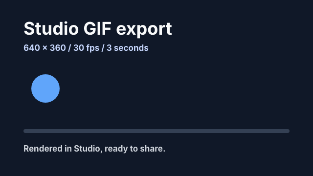

# Hyperframes PR #5593: GIF export evidence

Before UI: upstream main a11280eef. After UI: PR commit 1d74ae52bbe065e9ef28c6cec6302d7e8626d15b.

`before.png` shows the main-branch format picker without GIF. `after-controls.png` shows GIF selected with the 60 fps option disabled; `after.png` shows the completed render with loop count 3. `studio-export.gif` is the actual file downloaded after clicking Export in Studio, not a screen recording.

Verified with Chrome, FFmpeg, and ffprobe: 640 x 360, 3 seconds, 90 frames, 90 distinct decoded frames, loop count 3; download bytes equal the saved render. The source composition passed Hyperframes lint (0 errors, one structural warning for the progress-bar wrapper) and browser check (`ok: true`). The root explicitly paints its background so the GIF is readable on both light and dark pages.

